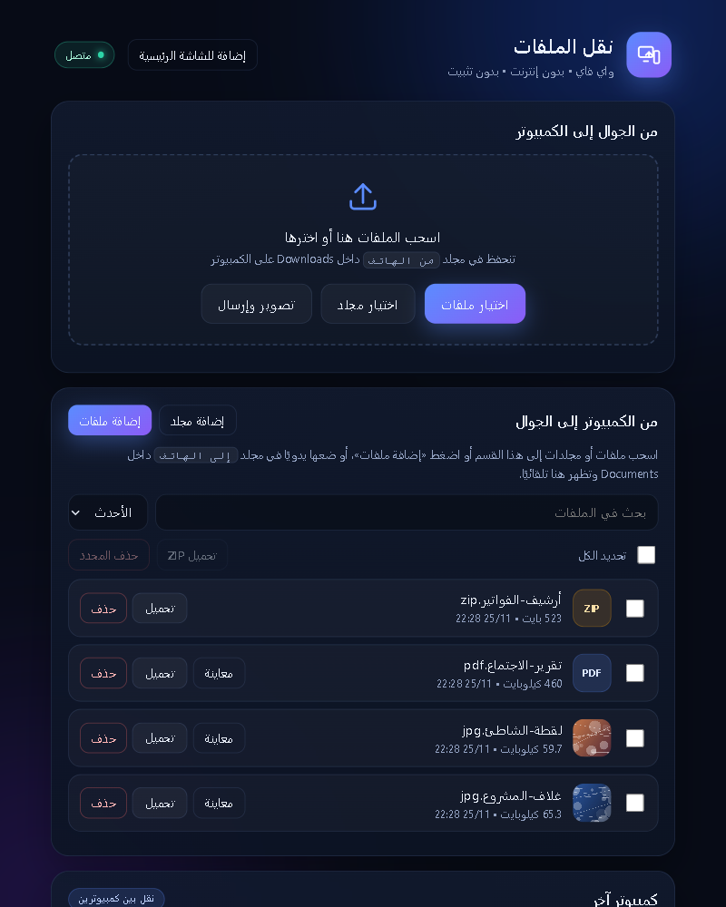

<div align="center">
  
  <h1>نقل الملفات عبر الواي فاي</h1>
  <p>تطبيق ويندوز محلي + واجهة ويب تفتح على الجوال — بدون إنترنت، بدون حساب، وبدون تثبيت على الجوال</p>
</div>

[](https://github.com/essa808/wifi-file-transfer/releases/latest)
[](https://github.com/essa808/wifi-file-transfer/releases/latest)



## تحميل التطبيق الجاهز

الملفات الجاهزة موجودة في صفحة **Releases** لهذا المستودع:

- `WiFi-File-Transfer-Setup.exe` — المثبت (يشمل Node.js ويعمل بدون إنترنت).
- `WiFi-File-Transfer-portable.zip` — نسخة محمولة بدون تثبيت.

الرابط المباشر: <https://github.com/essa808/wifi-file-transfer/releases/latest>

## المزايا

- إرسال الملفات من الجوال إلى الكمبيوتر (اختيار ملفات أو تصوير مباشر).
- إرسال الملفات من الكمبيوتر إلى الجوال مع مجلد مشترك وإضافة ملفات.
- اتصال سريع عبر رمز QR أو الرابط.
- ربط بين كمبيوترين على نفس الشبكة، مع موافقة من الطرفين وصلاحيات (إرسال / استقبال / كلاهما).
- تحميل عدة ملفات كملف ZIP، وحذف آمن إلى مجلد المحذوفات.
- تحديث لحظي للقوائم بين الأجهزة.
- لوحة نصوص سريعة (Clips) للنسخ واللصق بين الأجهزة.
- تشغيل بالخلفية مع اختصار في قائمة ابدأ وتشغيل تلقائي مع ويندوز.
- واجهة عربية (RTL) تعمل من متصفح الجوال.

## التشغيل

### الطريقة الأسهل

نزّل ملف التثبيت من صفحة **Releases** في هذا المستودع. المثبت يشمل Node.js ويعمل بدون إنترنت.

### من المصدر

المتطلبات: Windows و Node.js 18 أو أحدث.

```bash
npm install
npm start
```

أو شغّل `install.bat` للتثبيت المحلي وفتح المتصفح تلقائياً.

بعد التشغيل، افتح الرابط الظاهر أو امسح رمز QR من الجوال — يجب أن يكون الجهازان على نفس شبكة الواي فاي.

### بناء المثبت

1. ضع ملف `node-x64.msi` داخل مجلد `setup/`.
2. نفّذ `npm install`.
3. شغّل:

```powershell
powershell -ExecutionPolicy Bypass -File build-installer.ps1
```

سيظهر المثبت في مجلد `dist/`.

## بنية المشروع

```
server.js            خادم Express + منطق المشاركة والربط
public/              واجهة الويب (HTML/CSS/JS)
installer/           سكربتات التثبيت وإزالة التثبيت والأيقونة
build-installer.ps1  بناء مثبت IExpress
start.bat / stop.bat تشغيل وإيقاف الخادم
```

## الأمان

- كل جهاز ينشئ توكن دخول عشوائي (24 حرفاً) أول تشغيل، ويُخزَّن في `data/token.txt`.
- الطلبات من خارج الجهاز تحتاج هذا التوكن؛ رمز QR يحتوي الرابط مع التوكن، فلا تشارك صورته.
- الخادم مخصص للشبكة المحلية فقط — لا تنشر المنفذ على الإنترنت.
- مسارات الملفات محمية من الخروج عن مجلد المشاركة، والملفات القابلة للعرض داخل المتصفح محدودة بأنواع غير قابلة لتنفيذ سكربتات.
- الربط بين كمبيوترين يحتاج موافقة يدوية من المالك، ولكل جهاز توكن وصلاحيات مستقلة.
- مجلد `data/` (التوكن، الملفات المرفوعة، المجلد المشترك، السجلات) مستبعد من المستودع والمثبت.

## الترخيص

[MIT](LICENSE)
